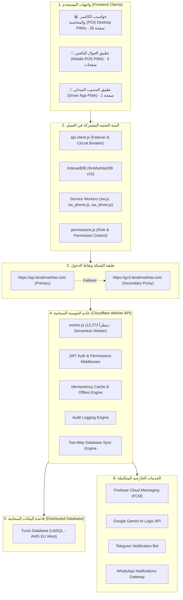
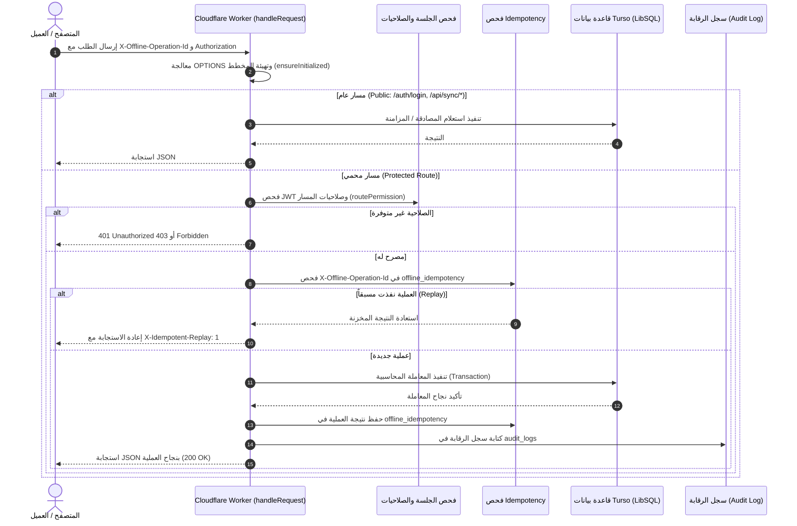

# المخطط المعماري والهندسي الشامل للنظام (System Architecture Blueprint)
**نظام نقاط البيع وإدارة الموارد المحاسبي المتكامل — ابن المختار (Ibn Al-Mukhtar POS ERP)**  
**الإصدار:** 2.0.0 ( الإنتاجي المحصن 100% )  
**تاريخ التوثيق:** 17 أكتوبر 2026  
**الهدف من الوثيقة:** تزويد أي مطور برمجيات أو نموذج ذكاء اصطناعي (AI Agent) بفهم شامل وهندسي دقيق لمكونات النظام، وهيكل قاعدة البيانات، وتوزيع الصفحات، والمسارات البرمجية، وآليات المزامنة غير المتصلة والحسابات المالية.

---

## 1. الملخص التنفيذي والهيكلي (Architecture & Tech Stack)

النظام عبارة عن منصة سحابية/محلية هجينة (Hybrid Offline-First Cloud Architecture) مخصصة لإدارة نقاط البيع، والمستودعات، والمشتريات، والموردين، والعملاء، والعمليات المحاسبية المزدوجة، وإدارة أسطول المندوبين والتوصيل:



### التقنيات المستخدمة (Technology Stack):
1. **الواجهة الأمامية (Frontend)**:
   - لغات أصلية بدون إطارات ثقيلة: Vanilla JavaScript (ES6+), HTML5 Semantic, CSS3 Custom Properties.
   - تطبيقات ويب تقدمية (PWA) مع تثبيت فوري ودعم كامل لوضع عدم الاتصال.
   - محرك التخزين المحلي: **IndexedDB** (`IbnMukhtarDB` الإصدار 10).
2. **الواجهة الخلفية (Backend API)**:
   - **Cloudflare Workers** (بيئة Serverless فائقة السرعة، وقت استجابة < 15ms عالمياً).
   - المعالج الرئيسي: [`worker.js`](file:///D:/pos-api/worker.js) بحجم 734KB (12,273 سطراً) يدعم معيار `nodejs_compat`.
3. **قاعدة البيانات (Database)**:
   - **Turso LibSQL** (محرك SQLite موزع عالمياً مبني على Rust ومستضاف في `aws-eu-west-1`).
4. **الأمان والمصادقة (Security)**:
   - توكنات JWT المشفرة، والتحقق الصارم من الصلاحيات لكل عملية (Granular RBAC).
   - حماية ضد تكرار العمليات عبر التخزين المؤقت للعمليات غير المتصلة (`offline_idempotency`).

---

## 2. الهيكل الفيزيائي للمشروع ومسارات الملفات (Workspace Directory)

```
D:\
├── pos-api/                          # مستودع الخادم السحابي (Cloudflare Worker)
│   ├── worker.js                     # محرك الخادم الرئيسي (12,273 سطراً)
│   ├── wrangler.toml                 # إعدادات النشر والمتغيرات البيئية
│   ├── package.json                  # إعدادات الموديول واستيراد @libsql/client/web
│   └── package-lock.json
│
└── IbnAlMukhtar-main-1/
    └── pos/                          # مستودع الواجهة الأمامية الكامل (Frontend)
        ├── *.html                    # 26 صفحة HTML لسطح المكتب ونقاط البيع
        ├── api-client.js             # طبقة الشبكة والتبديل التلقائي (Failover)
        ├── db.js                     # محرك IndexedDB المحلي للمتصفح
        ├── offline-sync.js           # منسق طابور المزامنة في الخلفية
        ├── offline-sw-core.js        # منطق Service Worker للعمل دون اتصال
        ├── sw.js                     # Service Worker الرئيسي لشاشات سطح المكتب
        ├── permissions.js            # محرك الصلاحيات وقواعد العرض والإخفاء
        ├── document-utils.js         # محرك بناء الفواتير والطباعة والباركود
        ├── number-utils.js           # دوال وتنسيقات الأرقام والمبالغ النقدية
        ├── date-utils.js             # دوال التواريخ الهجرية والميلادية
        ├── sidebar-config.js         # تهيئة وتوزيع القوائم الجانبية
        ├── unified-navigation.js     # توحيد شريط التنقل (Sidebar/Dropdown/Launcher)
        ├── notification-center-v3.js # مركز الإشعارات الفورية
        │
        ├── phone/                    # تطبيق الجوال المخصص للمبيعات السريعة
        │   ├── add_order_ph.html     # شاشة إنشاء وتعديل طلبات الجوال
        │   ├── index.html            # بوابة تحويل/لوحة الجوال
        │   ├── orders.html           # شاشة متابعة طلبات وحسابات الجوال
        │   ├── manifest.json         # مانيفست PWA للجوال
        │   └── sw_phone.js           # Service Worker المخصص للجوال
        │
        ├── driver/                   # تطبيق السائقين والمندوبين الميدانيين
        │   ├── index.html            # شاشة السائق الكاملة (استلام، تسليم، إرجاع، حساب)
        │   ├── db.js                 # محرك IndexedDB المخصص لبيانات السائق
        │   ├── manifest_pos.json     # مانيفست PWA للسائق
        │   └── sw_driver.js          # Service Worker المخصص للسائق
        │
        └── libs/                     # المكتبات المدمجة محلياً (html2canvas, xlsx, etc.)
```

---

## 3. مخطط وبيانات قاعدة البيانات (Database Schema - 10 Domains)

تعتمد قاعدة بيانات Turso على 35 جدولاً رئيسياً مقسمة عبر 10 قطاعات وظيفية مترابطة:

```mermaid
erDiagram
    USERS ||--o{ USER_PERMISSIONS : has
    USERS ||--o{ AUDIT_LOGS : performs
    CATEGORIES ||--o{ PRODUCTS : categorizes
    PRODUCTS ||--o{ PRODUCT_VARIANTS : has
    PRODUCTS ||--o{ STOCK_MOVEMENTS : tracks
    CUSTOMERS ||--o{ SALES : buys
    CUSTOMERS ||--o{ CUSTOMER_PAYMENTS : pays
    SALES ||--|{ SALE_ITEMS : contains
    SALES ||--o{ RETURNED_SALES : returns
    SUPPLIERS ||--o{ PURCHASE_INVOICES : supplies
    SUPPLIERS ||--o{ SUPPLIER_PAYMENTS : receives
    PURCHASE_INVOICES ||--|{ PURCHASE_INVOICE_ITEMS : contains
    ONLINE_ORDERS ||--|{ ONLINE_ORDER_ITEMS : contains
    ONLINE_ORDERS ||--o{ DELIVERY_ASSIGNMENTS : assigned
    DRIVERS ||--o{ DELIVERY_ASSIGNMENTS : delivers
    DRIVERS ||--o{ DRIVER_ACCOUNTS : owns
    DRIVERS ||--o{ DRIVER_TRANSACTIONS : transacts
    ACCOUNTS ||--o{ JOURNAL_ENTRY_DETAILS : belongs
    JOURNAL_ENTRIES ||--|{ JOURNAL_ENTRY_DETAILS : contains
    WALLETS ||--o{ WALLET_TRANSACTIONS : records
    WALLETS ||--o{ WALLET_BALANCES : holds
```



### قطاعات الجداول وتفاصيلها:

1. **قطاع الأمان والمستخدمين والرقابة**:
   - `users`: المستخدمين، كلمات المرور المشفرة بـ PBKDF2/SHA-256، الأدوار (`admin`, `cashier`, `accountant`, `driver`).
   - `user_permissions`: الصلاحيات الدقيقة المخصصة لكل مستخدم (تتجاوز الدور الافتراضي).
   - `audit_logs`: سجل الرقابة الصارم لكل طلب HTTP يغير البيانات (المستخدم، المسار، الـ IP، النتيجة).
   - `settings`: جدول المفتاح/القيمة لكافة إعدادات المنشأة والهوية والسياسات المحاسبية.

2. **قطاع الحسابات العامة والقيود المزدوجة (Double-Entry General Ledger)**:
   - `accounts`: شجرة الحسابات (الأصول، الخصوم، حقوق الملكية، الإيرادات، المصروفات).
   - `currencies`: العملات المعرفة (الريال اليمني `YER` العملة الأساسية، الريال السعودي `SAR`، الدولار الأمريكي `USD`) وأسعار الصرف الحالية.
   - `journal_entries`: القيود اليومية (الرقم، التاريخ، الوصف، المستخدم، الحالة).
   - `journal_entry_details`: أسطر القيد (رقم الحساب، المدين، الدائن، البيان، العملة، سعر الصرف).
   - `accounting_closures`: سجل الإقفالات السنوية/الشهرية وتاريخ الإقفال المحمي.
   - `cash_register`: سجل حركة النقدية والصندوق اليومي.
   - `cash_vouchers`: سندات القبض والصرف الرسمية.
   - `expenses`: المصروفات التشغيلية والمخصصة.

3. **قطاع المحافظ الإلكترونية (E-Wallets)**:
   - `wallets`: تعريف المحافظ والبنوك (كريمي، جيب، ون كاش، النجم، إلخ).
   - `wallet_balances`: رصيد كل محفظة مقسماً حسب العملة.
   - `wallet_transactions`: حركات الإيداع والسحب والتحويل عبر المحافظ.

4. **قطاع المستودع والمنتجات (Catalog & Inventory)**:
   - `categories`: شجرة التصنيفات الهرمية للمنتجات.
   - `products`: الأصناف (الاسم، الباركود، كود SKU، سعر التكلفة، سعر البيع، المخزون الإجمالي، حد الطلب).
   - `product_variants`: متغيرات المنتج (المقاسات، الألوان، الأطقم).
   - `product_supplier_stock`: كمية مخزون المنتج المربوطة بكل مورد محدد.
   - `stock_movements`: حركة الجرد (مشتريات، مبيعات، تسويات، مردودات).
   - `pending_products`: منتجات مضافة من الطلبات بانتظار الاعتماد المخزني.

5. **قطاع المبيعات ونقاط البيع (Sales & POS)**:
   - `sales`: الفواتير (رقم الفاتورة، التاريخ، العميل، نوع الدفع: نقد/آجل/محفظة/مختلط، العملة، الإجمالي، الخصم، الضريبة).
   - `sale_items`: أصناف الفاتورة (المنتج، الكمية، سعر الوحدة، التكلفة، الإجمالي، الخصم).
   - `returned_sales`: مردودات المبيعات وعكس القيود والمخزون.

6. **قطاع المشتريات والموردين (Purchases & Suppliers)**:
   - `suppliers`: بيانات الموردين، أرقام الهواتف، الأرصدة الافتتاحية والحالية.
   - `supplier_payments`: مدفوعات وسندات صرف الموردين.
   - `purchase_invoices`: فواتير المشتريات وتكاليف البضائع والعملة.
   - `purchase_invoice_items`: أصناف المشتريات وسعر الشراء وتحديث التكلفة.
   - `returned_purchases`: مردودات المشتريات للموردين.

7. **قطاع العملاء (Customers CRM)**:
   - `customers`: بيانات العملاء، الديون، السقوف الائتمانية.
   - `customer_payments`: سندات قبض مبالغ وسداد ديون العملاء.
   - `online_customers` & `online_customer_phones`: عملاء طلبات الإنترنت وسجل أرقام هواتفهم المتعددة.

8. **قطاع طلبات التوصيل وأسطول المندوبين (Fleet & Orders)**:
   - `online_orders`: طلبات المتجر والإنترنت وحالاتها (`جديد`, `قيد التجهيز`, `خرج للتوصيل`, `تم التسليم`, `مرتجع`).
   - `online_order_items`: تفاصيل أصناف طلب التوصيل.
   - `delivery_assignments`: سجل إسناد الطلبات للمندوبين وتاريخ ووقت التسليم.
   - `order_status_log`: سجل تاريخي زمني لتحولات حالة كل طلب.
   - `online_order_returns` & `online_order_return_items`: إرجاعات طلبات التوصيل.
   - `drivers`: المندوبين، أرقامهم، بيانات المركبات، بيانات الاعتماد وتوكنات الواتساب.
   - `driver_accounts` & `driver_transactions`: حسابات ديون وعهد المندوبين المالية.
   - `driver_order_receipts`: تسويات استلام الطلبات وتسليم العهد.

9. **قطاع المزامنة غير المتصلة والإشعارات (Sync & Idempotency)**:
   - `offline_idempotency`: تخزين نتائج الطلبات المنفذة برقم عملية فريد `operation_id` لمنع تكرار القيد عند انقطاع الشبكة وإعادة المحاولة.
   - `sync_outbox` & `sync_inbox`: سجل التغييرات المحلية للتوافق السحابي الثنائي.
   - `fcm_tokens` & `admin_fcm_tokens`: أجهزة وتوكنات إشعارات فايربيس للمندوبين والإدارة.

10. **قطاع الإحصاءات والتحليلات الجاهزة (Analytics)**:
    - `daily_product_stats`: تجميع آلي للمبيعات اليومية وتكلفة وربحية كل صنف.
    - `monthly_summary`: إجمالي الإيرادات والمصروفات والأرباح الشهرية.
    - `aging_summary`: تقارير أعمار الديون للعملاء والموردين.

---

## 4. دليل واجهات النظام الـ 30 (All 30 Frontend Views Directory)

تتوزع واجهات النظام الـ 30 على ثلاثة تصنيفات رئيسية:

### أ. واجهات سطح المكتب ونقاط البيع الرئيسية (26 واجهة في `pos/`)

| # | اسم الملف | الوظيفة الأساسية | العمليات ونقاط الاتصال البرمجية (Endpoints) | حالة التزامن |
|---|---|---|---|---|
| 1 | [`sale.html`](file:///D:/IbnAlMukhtar-main-1/pos/sale.html) | شاشة الكاشير والبيع السريع | `POST /sales`, `GET /products`, `GET /wallets`, `GET /currencies` | IndexedDB + Offline Sync |
| 2 | [`index.html`](file:///D:/IbnAlMukhtar-main-1/pos/index.html) | لوحة القيادة والمؤشرات العامة | `GET /summary`, `GET /stats/daily`, `GET /notifications` | مباشر مع كاش محلي |
| 3 | [`orders.html`](file:///D:/IbnAlMukhtar-main-1/pos/orders.html) | إدارة طلبات التوصيل والمندوبين | `GET /online-orders`, `POST /online-orders/assign`, `POST /driver-settlement` | تحديث لحظي + بحث متقدم |
| 4 | [`add_order.html`](file:///D:/IbnAlMukhtar-main-1/pos/add_order.html) | إنشاء وتعديل طلبات الإنترنت | `POST /online-orders`, `PUT /online-orders/:id`, `GET /customers/phone/:p` | دعم مسودات محلية |
| 5 | [`add_order_ph.html`](file:///D:/IbnAlMukhtar-main-1/pos/add_order_ph.html) | جسر التحويل لتطبيق الجوال | إعادة توجيه ذكية إلى `phone/add_order_ph.html` | توجيه متجاوب |
| 6 | [`products.html`](file:///D:/IbnAlMukhtar-main-1/pos/products.html) | إدارة الدليل المخزني والأصناف | `GET/POST/PUT/DELETE /products`, `POST /products/bulk-category` | ترحيل مخزني وفئات |
| 7 | [`inventory.html`](file:///D:/IbnAlMukhtar-main-1/pos/inventory.html) | الجرد الفعلي وتسوية المخزون | `POST /inventory/adjust`, `GET /inventory/report` | تسوية فروق الجرد |
| 8 | [`stock-movements.html`](file:///D:/IbnAlMukhtar-main-1/pos/stock-movements.html) | سجل تتبع حركات المخزون | `GET /products/:id/stock-movements`, `GET /stock-movements` | تصفية تاريخية وصنفية |
| 9 | [`purchases.html`](file:///D:/IbnAlMukhtar-main-1/pos/purchases.html) | إدارة فواتير المشتريات | `GET/POST /purchases`, `POST /purchases/return` | قيود مخزن وحساب مورد |
| 10 | [`invoices.html`](file:///D:/IbnAlMukhtar-main-1/pos/invoices.html) | أرشيف فواتير البيع وإدارتها | `GET /sales`, `POST /sales/:id/cancel`, `GET /sales/:id/print` | طباعة وتصدير وإلغاء |
| 11 | [`operations.html`](file:///D:/IbnAlMukhtar-main-1/pos/operations.html) | العمليات السريعة والإرجاع | `POST /sales/return`, `POST /purchases/return`, `GET /sales/:id` | فحص الكميات المتاحة للإرجاع |
| 12 | [`customers.html`](file:///D:/IbnAlMukhtar-main-1/pos/customers.html) | دليل العملاء وحسابات الديون | `GET/POST /customers`, `GET /customers/:id/statement`, `POST /customer-payments` | كشوفات حساب تفصيلية |
| 13 | [`suppliers.html`](file:///D:/IbnAlMukhtar-main-1/pos/suppliers.html) | دليل الموردين ومستحقاتهم | `GET/POST /suppliers`, `GET /suppliers/:id/statement`, `POST /supplier-payments` | إدارة ذمم الموردين |
| 14 | [`payments.html`](file:///D:/IbnAlMukhtar-main-1/pos/payments.html) | سندات القبض والصرف العامة | `GET/POST /vouchers`, `GET /cash-register/balance` | قيود نقدية ومحافظ آلية |
| 15 | [`expenses.html`](file:///D:/IbnAlMukhtar-main-1/pos/expenses.html) | تسجيل ومتابعة المصروفات | `GET/POST /expenses`, `GET /expenses/categories` | خصم فوري من الصندوق/المحفظة |
| 16 | [`cash-wallets.html`](file:///D:/IbnAlMukhtar-main-1/pos/cash-wallets.html) | إدارة الخزينة والمحافظ | `GET /wallets`, `POST /wallets/transfer`, `GET /cash-register` | تحويل بين العملات والمحافظ |
| 17 | [`journal.html`](file:///D:/IbnAlMukhtar-main-1/pos/journal.html) | القيود اليومية المحاسبية | `GET/POST /journal-entries`, `GET /accounts` | فحص توازن المدين والدائن |
| 18 | [`reports.html`](file:///D:/IbnAlMukhtar-main-1/pos/reports.html) | التقارير المالية والختامية | `GET /reports/trial-balance`, `GET /reports/income-statement`, `GET /reports/balance-sheet` | ميزان المراجعة وقائمة الدخل |
| 19 | [`reports_central.html`](file:///D:/IbnAlMukhtar-main-1/pos/reports_central.html) | التقارير المركزية المجمعة | `GET /reports/central-summary`, `GET /reports/profit-loss` | كشوفات متعددة العملات |
| 20 | [`online-reports.html`](file:///D:/IbnAlMukhtar-main-1/pos/online-reports.html) | تقارير التوصيل والمبيعات | `GET /reports/online-orders`, `GET /reports/driver-performance` | أداء المندوبين وأرباح الشحن |
| 21 | [`audit-logs.html`](file:///D:/IbnAlMukhtar-main-1/pos/audit-logs.html) | سجل رقابة العمليات والأنشطة | `GET /audit-logs`, `GET /audit-logs/users`, `GET /audit-logs/export` | سجل أمني غير قابل للتعديل |
| 22 | [`barcode-print.html`](file:///D:/IbnAlMukhtar-main-1/pos/barcode-print.html) | مصمم وطباعة باركود الأصناف | `GET /products`, `GET /purchases/:id` | طباعة ملصقات وشيتات A4 |
| 23 | [`settings.html`](file:///D:/IbnAlMukhtar-main-1/pos/settings.html) | إعدادات النظام والهوية | `GET/POST /settings`, `POST /accounting/close-year`, `POST /accounting/initialize` | تهيئة محاسبية وحفظ الهوية |
| 24 | [`site-integration.html`](file:///D:/IbnAlMukhtar-main-1/pos/site-integration.html) | ربط المتجر الإلكتروني الخارجي | `POST /sync/push`, `GET /sync/pull`, `POST /site/webhook` | مزامنة المخزون والطلبات |
| 25 | [`notification-test.html`](file:///D:/IbnAlMukhtar-main-1/pos/notification-test.html) | منصة اختبار الإشعارات | `POST /test-notification`, `GET /fcm-tokens` | فحص وصول إشعارات FCM |
| 26 | [`driver1.html`](file:///D:/IbnAlMukhtar-main-1/pos/driver1.html) | لوحة المندوب السريعة المدمجة | `GET /driver/orders`, `POST /driver/status-update` | مزودة بـ `api-client.js` |

---

### ب. واجهات الجوال وتطبيق المندوب الميداني (4 واجهات متخصصة)

| # | مسار الملف | الفئة المستهدفة | الوظيفة الفنية | الميزات الخاصة |
|---|---|---|---|---|
| 27 | [`phone/add_order_ph.html`](file:///D:/IbnAlMukhtar-main-1/pos/phone/add_order_ph.html) | بائعو الجوال | إنشاء وتعديل طلبات المبيعات السريعة من الهاتف | ماسح كاميرا مدمج، مسودات محلية، 33 زراً قياسياً |
| 28 | [`phone/index.html`](file:///D:/IbnAlMukhtar-main-1/pos/phone/index.html) | بائعو الجوال | بوابة الدخول ولوحة المعلومات السريعة للجوال | استعراض سريع، تبديل بين الشاشات، PWA |
| 29 | [`phone/orders.html`](file:///D:/IbnAlMukhtar-main-1/pos/phone/orders.html) | مسؤولو المبيعات | إدارة ومتابعة الطلبات، تسويات وتكليف المندوبين | كشوفات حساب السائقين، فلاتر سريعة، 40 زراً قياسياً |
| 30 | [`driver/index.html`](file:///D:/IbnAlMukhtar-main-1/pos/driver/index.html) | المندوبون الميدانيون | استلام الطلبات، التنقل، تسليم البضائع وتأكيد القبض | IndexedDB خاص، دعم كامل بدون شبكة، إرجاع طلبات |

---

## 5. البنية التحتية المشتركة في العميل (Core Shared Modules)

تحتوي الواجهة الأمامية على طبقة مكتبات أساسية مشتركة بدون أي تبعيات خارجية (Zero-Dependency):

1. **`api-client.js` (نظام الاتصال والتبديل التلقائي - Failover Proxy)**:
   - يغلف دالة `window.fetch` العالمية تلقائياً.
   - يعترض أي استدعاء للنطاق الأساسي `https://api.ibnalmukhtar.com`.
   - في حال تعثر الاتصال، أو حدوث خطأ خادم (5xx)، أو تجاوز مهلة 7 ثوانٍ، يقوم بالتبديل التلقائي الفوري إلى النطاق البديل `https://go3.ibnalmukhtar.com`.
   - يحتوي على مراقب دوري (Heartbeat Health Monitor كل دقيقة) لفحص عودة النطاق الأساسي والرجوع إليه آلياً.

2. **`offline-sync.js` و `sw.js` (محرك العمليات غير المتصلة - Offline Engine)**:
   - يُثبّت معرّف عملية فريد `X-Offline-Operation-Id` لكل طلب تعديل بيانات (POST/PUT/DELETE).
   - في حال غياب الشبكة، يقوم بحفظ العملية في طابور `IndexedDB`.
   - عند عودة الشبكة، يتم تفريغ الطابور بمزامنة تسلسلية تمنع أي تكرار محاسبي أو مخزني بفضل صمام الـ Idempotency في الخادم.

3. **`permissions.js` (نظام الصلاحيات والأمان في العميل - RBAC)**:
   - يفحص رمز JWT المخزن ويستخرج صلاحيات المستخدم.
   - يتحكم في إخفاء أو تعطيل عناصر الواجهة تلقائياً بناءً على وسم `data-permission`.
   - يمنع تنفيذ أي عملية حساسة (مثل إلغاء الفاتورة، أو البيع بالسالب، أو تعديل سعر التكلفة) إلا لمن يملك الصلاحية الصريحة.

4. **`document-utils.js` (محرك الطباعة الموحد - Invoice & Receipt Generator)**:
   - مسؤول عن توليد فواتير المبيعات، والمشتريات، وسندات القبض، وكشوفات الحساب.
   - يدعم الطباعة الحرارية المباشرة (ESC/POS 80mm & 58mm) وطباعة الورق القياسي (A4).
   - يقوم بتوليد باركود SVG محلياً دون الحاجة لمكتبات ثقيلة، ويتحكم في الشعار وألوان الهوية المحفوظة من الإعدادات.

5. **`number-utils.js` و `date-utils.js` (المعالجات المالية والزمنية)**:
   - دقة مالية صارمة: تقريب المبالغ إلى منزلتين عشريتين ومنع أخطاء الفاصلة العائمة (Floating-Point Drift).
   - دعم كامل للتحويل بين التاريخ الميلادي والتقويم الهجري، وتنسيق الأرقام القياسي.

---

## 6. خادم الحوسبة السحابية (Cloudflare Worker API Reference)

يُدار الخادم عبر ملف موحد ومدروس بعناية [`D:\pos-api\worker.js`](file:///D:/pos-api/worker.js).

### دورة حياة معالجة الطلب (Request Lifecycle Pipeline):



### ملخص المسارات البرمجية الرئيسية (97 نقطة نهاية فريدة):
- **المصادقة**: `POST /auth/login`, `GET /auth/me`, `POST /auth/logout`.
- **المبيعات**: `GET /sales`, `POST /sales`, `GET /sales/:id`, `POST /sales/:id/cancel`, `POST /sales/return`.
- **المشتريات**: `GET /purchases`, `POST /purchases`, `GET /purchases/:id`, `POST /purchases/return`.
- **المنتجات والمخزون**: `GET/POST/PUT/DELETE /products`, `POST /products/bulk-category`, `GET /products/:id/stock-movements`, `POST /inventory/adjust`, `POST /products/generate-sku`.
- **العملاء والموردين**: `GET/POST/PUT /customers`, `GET/POST/PUT /suppliers`, `POST /customer-payments`, `POST /supplier-payments`, `GET /customers/:id/statement`, `GET /suppliers/:id/statement`.
- **الطلبات والتوصيل**: `GET/POST /online-orders`, `PUT /online-orders/:id`, `POST /online-orders/assign`, `POST /online-orders/:id/status`, `POST /driver-settlement`, `POST /online-orders/returns`.
- **المحاسبة والمالية**: `GET/POST /journal-entries`, `GET /accounts`, `POST /accounting/close-year`, `POST /accounting/reopen`, `POST /accounting/initialize`, `GET/POST /vouchers`, `GET/POST /expenses`, `GET /wallets`, `POST /wallets/transfer`.
- **المزامنة السحابية والثنائية**: `GET /api/sync/pull`, `POST /api/sync/push`, `GET /api/sync/summary`, `GET /api/sync/snapshot`.
- **الإعدادات والنسخ الاحتياطي**: `GET/POST /settings`, `GET /export-data`, `POST /import-data`.

---

## 7. القواعد والمعايير المحاسبية المتبعة (Accounting Mechanics)

1. **العملات المتعددة وسعر الصرف الأساسي (Base Currency Equation)**:
   - العملة الأساسية للنظام هي **الريال اليمني (YER)**.
   - لكل عملة أجنبية سعر تحويل مسجل `rate_to_base`.
   - تحويل المبالغ للعملة الأساسية يتم وفق القانون الصارم:
     $$\text{Amount (YER)} = \text{Foreign Amount} \times \text{Exchange Rate}$$
   - أي تقرير أرباح وخسائر أو ميزانية عمومية يقوم بتوحيد الأرصدة تلقائياً بالريال اليمني لتجنب تضارب العملات.

2. **قيد التأسيس الآلي (Automated Initialization Baseline)**:
   - يتم تفعيل قيد التأسيس مرة واحدة فقط عند بدء تشغيل المنشأة عبر مسار `/accounting/initialize`.
   - يقوم النظام بتجميع:
     - إجمالي قيمة المخزون الحالي (سعر التكلفة $\times$ الكمية).
     - إجمالي أرصدة الصناديق والمحافظ النقدية.
     - إجمالي ديون العملاء (مدينون).
     - إجمالي ذمم الموردين (دائنون).
   - ويقوم بإنشاء القيد الافتتاحي الموزون وتوجيه الفرق تلقائياً إلى حساب **رأس المال الافتتاحي (Opening Equity)** مع تفعيل الحماية `system_initialized = 1`.

3. **توازن القيد المزدوج الإجباري (Double-Entry Balance Constraint)**:
   - لا يقبل الخادم في دالة `checkBalance()` أي قيد محاسبي إلا إذا تحقق الشرط الحسابي:
     $$|\sum \text{Debit} - \sum \text{Credit}| \le 0.001$$
   - يُرفض فوراً أي قيد يحتوي على سطر صفري أو سطر يجمع بين المدين والدائن في آن واحد.

4. **إقفال الفترة المحاسبية (Accounting Lock Protection)**:
   - عند إقفال السنة/الشهر عبر `/accounting/close-year` يتم تسجيل تاريخ `closed_until_date`.
   - تمنع دالة `checkIfClosed()` في الخادم إنشاء أي فاتورة بيع، أو شراء، أو سند قبض/صرف، أو تعديل قيود في أي تاريخ يقع قبل أو يساوي تاريخ الإقفال.

---

## 8. إرشادات وقواعد التطوير لأي ذكاء اصطناعي (AI Developer Guidelines)

إذا كنت نموذج ذكاء اصطناعي مكلفاً بفحص، أو تعديل، أو إضافة ميزة على هذا النظام، **عليك الالتزام الصارم بالقواعد التالية دون أي استثناء**:

1. **قاعدة المعرّفات القياسية للأزرار (Standard Interactive Button IDs)**:
   - يجب أن يمتلك كل زر تفاعلي في الـ HTML معرّفاً صريحاً وفريداً `id="btn-..."`.
   - لا تقم أبداً بإنشاء زر تفاعلي بدون معرّف، حتى تضمن قابلية الاختبار الآلي وقابلية الوصول.

2. **قاعدة تحصين استدعاءات الـ JSON (Resilient JSON Parsing)**:
   - يُحظر استدعاء `res.json()` بدون صمام أمان. الصيغة المعتمدة الوحيدة في المشروع هي:
     ```javascript
     const data = await res.json().catch(() => ({}));
     ```

3. **حماية التزامن ومنع النقر المزدوج (Concurrency Locking)**:
   - عند كتابة أي دالة تقوم بعملية مالية، أو حفظ طلب، أو إلغاء فاتورة، يجب وضع قفل تزامن مع مؤشر تحميل:
     ```javascript
     if (isSubmitting) return;
     try {
       isSubmitting = true;
       btn.disabled = true;
       // ... execution ...
     } finally {
       isSubmitting = false;
       btn.disabled = false;
     }
     ```

4. **نهايات الأسطر (CRLF vs LF) وسلامة التعديل على القرص**:
   - بيئة التطوير تعمل على نظام Windows. انتبه إلى أن بعض الملفات تستخدم نهايات أسطر `\r\n` (CRLF) وبعضها `\n` (LF).
   - قبل إجراء أي استبدال للأسطر، تحقق من صيغة نهايات الأسطر وتأكد من أن النص المستهدف يطابق تماماً بنية الملف، وتحقق من صحة بناء الجملة (Syntax Check) عبر `node:vm` قبل الحفظ وبعده.

5. **الحفاظ على سلامة المصطلحات المحاسبية والتعريب**:
   - واجهة المستخدم بالكامل باللغة العربية (RTL).
   - حافظ على التسميات المحاسبية المعتمدة (مدين، دائن، ميزان المراجعة، قائمة الدخل، سند قبض، سند صرف، إقفال الفترة).
   - لا تحذف أي تعليقات توضيحية أو دوال مساعدة قائمة إلا إذا طلب المستخدم ذلك صراحة.
